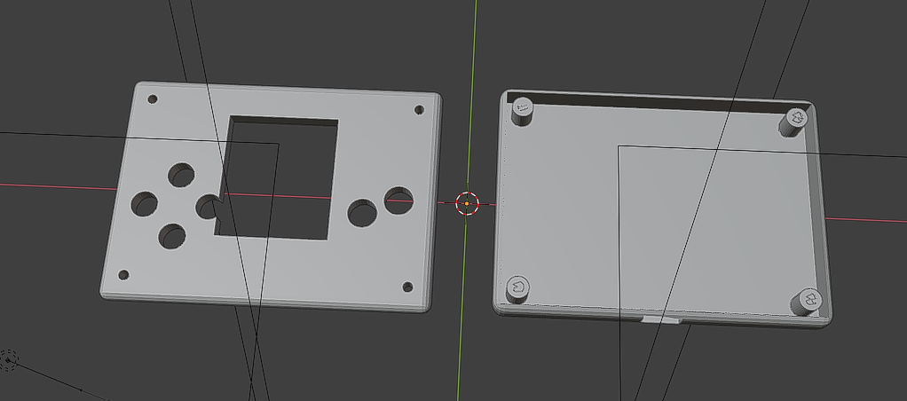
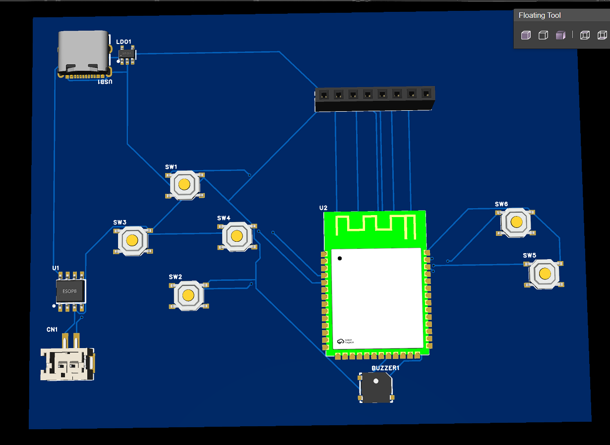
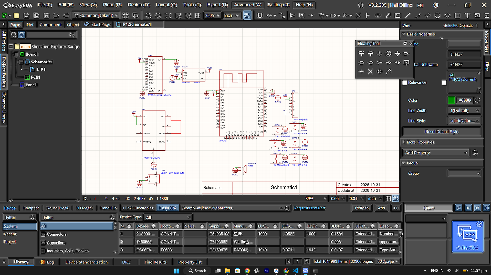

# Shenzhen Explorer // Cyber-Badge



A handheld cyberpunk electronic badge, pocket console, and wireless maker-mesh device built for **Maker Faire Shenzhen 2026** and **Hack Club Fallen**.

---

## 💡 Why I Made This

Going to Maker Faire Shenzhen has been a huge dream of mine. Shenzhen and Huaqiangbei are the world capitals of electronics manufacturing and hardware hacking, so I wanted to build a badge that actually belongs in that environment: something interactive, tactile, fun to play with, and packed with cool RF features to use while walking around the faire.

Most conference badges end up as static blinking lights that people throw in a drawer. I wanted to build something I would genuinely play with every single day:
1. **A pocket arcade machine** with tactile buttons, a bright IPS screen, and classic games to challenge friends.
2. **An RF scanner and radar** to visualize the massive 2.4GHz Wi-Fi and Bluetooth airwaves around Huaqiangbei.
3. **A wireless social handshake tool** where two people wearing the badge can bump into each other and exchange digital contact cards over ESP-NOW without needing any phone or internet connection.

---

## 🕹️ What It Does & How to Use It

The badge is powered by an **ESP32-S3** microcontroller and features a 1.69" 240x280 IPS color display, a 4-way directional D-pad, action buttons (A and B), a piezo buzzer for 8-bit sound effects, and rechargeable USB-C LiPo power.

```
       [ 1.69" IPS LCD ]
           +-------+
   (UP)    | 240x  |    (A) Action
(L) + (R)  |  280  |  (B) Back/Jump
  (DOWN)   +-------+
```

### Core Features:
- **Maker Social Handshake (ESP-NOW):** When two attendees wearing the badge get close, their badges automatically detect each other, exchange maker handles and pixel avatars, and store the contact into onboard flash memory.
- **Huaqiangbei RF Environment Radar:** Visualizes real-time 2.4GHz beacon density and Wi-Fi channels as an animated cyberpunk radar scanner.
- **Built-in 6-in-1 Retro Cyber-Arcade:**
  - **Shenzhen Invaders:** Classic arcade space defense with marching waves, bunkers, and laser cannons.
  - **Cyber Snake:** Responsive 4-way D-pad neon snake with speed boost on Button A.
  - **Shenzhen Breakout:** High-velocity paddle brick breaker with destructible chips.
  - **Flappy Cyber-Drone:** Precision gravity tapping through neon laser obstacles.
  - **Highway Racer:** Top-down highway dodging traffic cars and road stripes.
  - **Cyber Blocks:** Classic falling tetromino game with rotation and line-clear combo scoring.

---

## 🛠️ Hardware Engineering & Design

### 1. 3D Mechanical Enclosure
I designed a custom two-piece snap-fit enclosure in Blender, specifically tailored for 3D printing in Tough PLA / PETG:


- **Upper Shell:** Features recessed bezels for the 1.69" IPS screen, tactile cross-pattern cutouts for the D-pad and action buttons, and reinforced screw bosses.
- **Lower Shell:** Houses the 500mAh LiPo battery, USB-C side cutout for charging while assembled, and internal clearances for surface-mount components.
- Printable STLs and Blender sources:
  - Source Blender 3D Model: [`cad/cyber_badge_case.blend`](cad/cyber_badge_case.blend)
  - Front Shell STL: [`cad/cyber_badge_upper_shell_print.stl`](cad/cyber_badge_upper_shell_print.stl)
  - Back Shell STL: [`cad/cyber_badge_lower_shell_print.stl`](cad/cyber_badge_lower_shell_print.stl)

### 2. Custom 2-Layer PCB
The board was laid out with dedicated ground planes, short high-speed SPI trace routing for the ST7789 display, and an RF keepout zone around the ESP32-S3 PCB antenna.



- Complete production-ready Gerbers: [`Gerber_PCB1_2026-11-02.zip`](Gerber_PCB1_2026-11-02.zip)

### 3. Circuit Schematic
The circuit integrates full battery charging, power regulation, and ESD protection:



- **Power Input:** USB-C (16-pin) with 5.1k CC pull-down resistors for USB-PD compatibility.
- **Battery Management:** TP4056 lithium charge IC with LED charging status indicators.
- **Voltage Regulation:** ME6211 3.3V 500mA ultra-low-dropout regulator.
- **Audio & Haptics:** Direct PWM-driven SMD piezo sounder for 8-bit audio frequencies.
- Detailed GPIO pinout table: [`hardware/pinout.md`](hardware/pinout.md)

---

## 📊 Bill of Materials & Budget

Every component was chosen to keep the build accessible, affordable, and easy to solder:

* Itemized BOM spreadsheet: [`bom.csv`](bom.csv)
* **Total Project Cost:** **$70.00 USD** (includes 10x custom PCBs, all electronic components, LiPo battery, hardware fasteners, international tracked shipping, and a complete beginner soldering iron kit).

---

## 💻 Firmware & Source Code

The firmware is written in clean, modern C++ for the ESP32-S3 using PlatformIO / Arduino:
- [`firmware/main.cpp`](firmware/main.cpp) — State machine controller, menus, and application manager.
- [`firmware/include/pins.h`](firmware/include/pins.h) — Hardware pin definitions and display bus config.
- [`firmware/include/input.h`](firmware/include/input.h) — Debounced button input handler.
- [`firmware/include/radar.h`](firmware/include/radar.h) — 2.4GHz Wi-Fi promiscuous packet sniffer & radar renderer.
- [`firmware/include/audio.h`](firmware/include/audio.h) — Non-blocking 8-bit chiptune sound generator.
- [`firmware/include/`](firmware/include/) — Individual standalone game engines (Invaders, Snake, Breakout, Flappy, Racer, Tetris).

---

## 📁 Repository Structure

```text
├── README.md                           # Project showcase and build guide
├── bom.csv                             # Full bill of materials with vendor links ($70.00)
├── Gerber_PCB1_2026-11-02.zip          # Production-ready PCB Gerbers
├── assets/                             # Real hardware and CAD captures
│   ├── cyber_badge_enclosure_3d.png    # 3D enclosure assembly (both shells)
│   ├── cyber_badge_pcb_3d.png          # 3D PCB layout render
│   ├── cyber_badge_schematic.png       # Complete circuit schematic
│   ├── enclosure_front.png             # Front shell close-up
│   └── enclosure_back.png              # Back shell close-up
├── cad/                                # 3D models and printable files
│   ├── cyber_badge_case.blend          # Master Blender 3D model
│   ├── cyber_badge_upper_shell_print.stl
│   └── cyber_badge_lower_shell_print.stl
├── firmware/                           # Complete C++ firmware
│   ├── main.cpp                        # Main entry point and state machine
│   └── include/                        # Game engines, RF radar, input, audio
└── hardware/
    └── pinout.md                       # Complete GPIO pinout table
```

---

## 👤 Author
**Arfat Ansari**  
Built for **Hack Club Fallen** and **Maker Faire Shenzhen 2026**.
