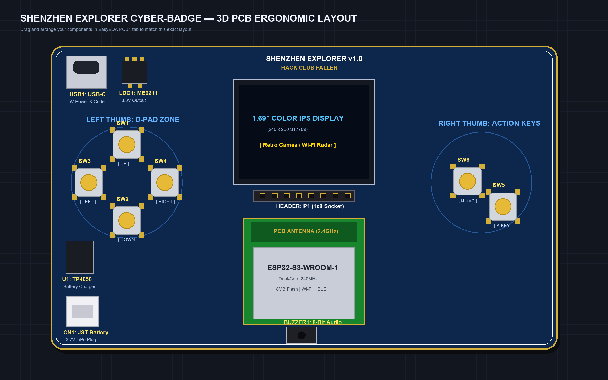
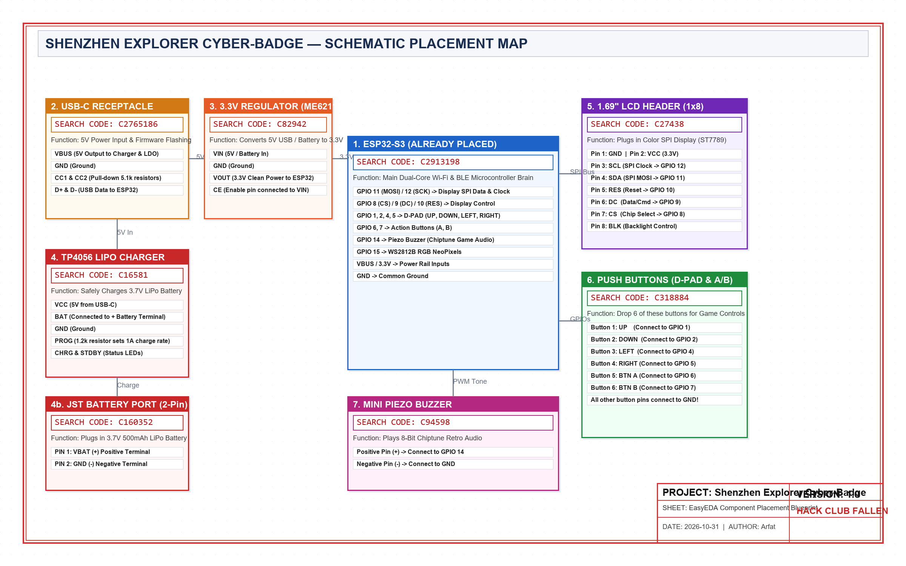

# Shenzhen Explorer Cyber-Badge & Cyber-Dock (Hack Club Fallen)


## 🌟 Project Overview
The **Shenzhen Explorer** is an open-source, interactive cyberpunk electronic badge and handheld console designed for **Maker Faire Shenzhen 2026**. Powered by the dual-core **ESP32-S3** microcontroller, it combines tactile retro arcade gaming, wireless peer-to-peer social badge trading, and real-time 2.4GHz RF spectrum scanning into a pocketable, rechargeable device.

Accompanying the badge is the **Cyber-Dock**, a dedicated smart charging cradle featuring ambient RGB underglow and an OLED diagnostic dashboard.

---

## 🚀 Why This Project Qualifies for Hack Club Fallen

| Qualification Requirement | How Shenzhen Explorer Meets It |
| :--- | :--- |
| **Physical Hardware** | Custom 2-layer PCB designed from scratch with USB-C, power management, and surface-mount components. |
| **Interactive Demo** | Visitors at Maker Faire Shenzhen can play arcade games, test live wireless radar scanning, or touch badges to exchange digital maker cards. |
| **Original Engineering** | Custom circuit layout, custom firmware in C++/Arduino, and 3D printed mechanical snap-fit enclosures. |
| **Travel & Presentation Ready** | Ultra-portable, battery-powered (rechargeable via standard USB-C), hangs comfortably on a lanyard. |
| **Frugal & Justified BOM** | Total component & fabrication cost is ~$70.00 for the badge and ~$35.00 for the dock, well within Hack Club's grant budget limits. |

---

## 📸 Hardware & 3D Engineering Showcase

### 1. 3D Mechanical Assembly
The badge features a snap-fit dual-shell enclosure specifically modeled and optimized for FDM 3D printing in Tough PLA / PETG.


* Source Blender file: [`cad/cyber_badge_case.blend`](cad/cyber_badge_case.blend)
* 3D Printable STLs: [`cad/cyber_badge_upper_shell_print.stl`](cad/cyber_badge_upper_shell_print.stl) and [`cad/cyber_badge_lower_shell_print.stl`](cad/cyber_badge_lower_shell_print.stl)

### 2. Custom 2-Layer Circuit Board (PCB)
The PCB was routed with high-speed trace guidelines for the 240x280 SPI display bus and integrated 2.4GHz RF antenna clearance.



* Ready-to-order Gerbers: [`Gerber_PCB1_2026-11-02.zip`](Gerber_PCB1_2026-11-02.zip)

### 3. Circuit Schematic & Hardware Pinout
Equipped with TP4056 single-cell lithium charging, 3.3V 500mA LDO power regulation, and ESD decoupling.



* Detailed pinout matrix: [`hardware/pinout.md`](hardware/pinout.md)

---

## 🕹️ Core Firmware Features

### 1. Maker Social Handshake (ESP-NOW & BLE)
* When two attendees wearing the badge stand within range, the badges automatically exchange digital business cards, GitHub handles, and custom 16x16 pixel avatars.
* Saves encountered makers into internal flash memory to review after the faire.

### 2. Huaqiangbei RF Environment Radar
* Live packet sniffer and signal density visualizer.
* Displays 2.4GHz Wi-Fi channels, beacon density, and Bluetooth devices in real time as an animated sci-fi radar.

### 3. Tactile Retro Cyber-Arcade (6-in-1 Suite)
* Crisp 1.69" IPS color screen (240x280) running a dedicated retro gaming suite:
  * **Shenzhen Invaders:** Space Invaders arcade clone with marching alien waves and laser cannons.
  * **Cyber Snake:** Smooth 4-way D-Pad neon snake with turbo boost on Button A.
  * **Shenzhen Breakout:** High-speed paddle brick breaker with 2 Destructible microchips.
  * **Flappy Cyber-Drone:** Thrust against gravity through neon laser gate obstacles.
  * **Highway Racer:** Top-down neon highway dodge racer with traffic cars and road stripes.
  * **Cyber Blocks:** Classic Tetris with 7 falling tetrominoes, rotation on Button A, and line-clear bonuses.
* Piezo sound engine for authentic 8-bit chiptune sound effects.

---

## ⚡ Companion Station: The Cyber-Dock


The **Cyber-Dock** acts as the home base for the Shenzhen Explorer Badge:
* Magnetic / Pogo-pin charging interface with USB-C power delivery.
* 6x Addressable WS2812B NeoPixel LEDs for dynamic desktop underglow.
* 0.96" I2C OLED display showing charging telemetry and local ambient status.
* Full details in [`cyber-dock/README.md`](cyber-dock/README.md).

---

## 📊 Bill of Materials & Budget

All components have been selected for cost-efficiency and direct availability through LCSC and JLCPCB:

* **Shenzhen Explorer Badge BOM:** [`bom.csv`](bom.csv) — **Total: $70.00 USD** (including 10x PCBs, parts, international shipping to India, and beginner soldering kit)
* **Cyber-Dock BOM:** [`cyber-dock/bom.csv`](cyber-dock/bom.csv) — **Total: $35.00 USD** (including 5x PCBs, pogo-pins, OLED, and shipping)

---

## 🛠️ Repository Directory Structure

```text
├── README.md                           # Main showcase and documentation
├── bom.csv                             # Itemized Bill of Materials with purchase links
├── Gerber_PCB1_2026-11-02.zip          # Production-ready JLCPCB Gerbers
├── cad/                                # 3D models and printable STLs
│   ├── cyber_badge_case.blend          # Master Blender 3D model
│   ├── cyber_badge_upper_shell_print.stl
│   ├── cyber_badge_lower_shell_print.stl
│   └── cyber_badge_full_render.png
├── firmware/                           # Complete C++ firmware
│   └── src/main.cpp                    # Game engines, radar, and social handshake
├── hardware/
│   └── pinout.md                       # Complete GPIO pinout table
└── cyber-dock/                         # Companion smart dock project
    ├── README.md
    ├── bom.csv
    ├── Cyber-Dock.kicad_pcb            # Native KiCad PCB design
    ├── Cyber-Dock.kicad_pro
    ├── cyber_dock.blend
    └── cyber_dock_chassis_print.stl
```

---

## 👤 Author
**Arfat Ansari** (Teanbris Studio)  
Built with passion for **Hack Club Fallen** and the **Maker Faire Shenzhen 2026** showcase.
